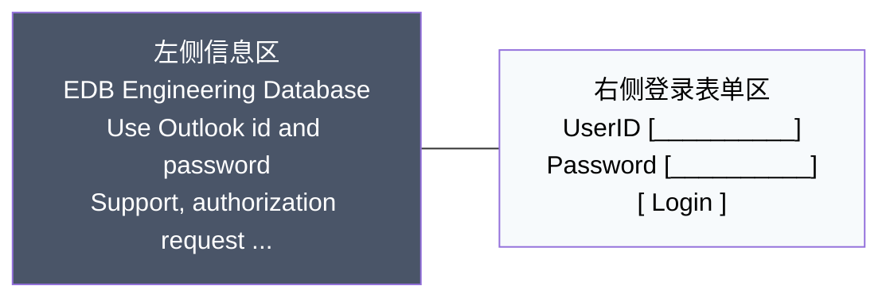

# 登录模块 (Login Module) 详细设计说明书

| 文档编号           | DES-Login-001          | 版本号     | v1.0       |
| :----------------- | :--------------------- | :--------- | :--------- |
| **模块名称**       | 用户登录 (Login)       | **作成日** | 2026-09-11 |
| **作成者**         | GitHub Copilot         | **状态**   | 正式稿     |

---

## 1. 背景 (Background)

### 1.1 核心功能和目标

本模块提供用户登录认证功能，是系统的入口页面。用户通过输入用户名和密码进行身份验证，认证成功后跳转到主菜单页面（Menu）。

- **目标**：确保只有授权用户能够进入系统，并提供清晰、即时的错误反馈。
- **定位**：系统入口页面，所有业务功能的必经前置环节。

### 1.2 面向的用户群体

- 系统注册用户
- 需要访问 EDB Engineering Database 的工程人员

### 1.3 用户体验方面的考虑

- 简洁直观的登录界面
- 清晰的错误提示信息
- 响应式布局，适配不同屏幕尺寸
- 提供备选登录链接以应对账户锁定情况

### 1.4 安全性或特殊要求

- 密码输入需要隐藏显示（掩码显示）
- 支持半角英数字和符号
- 账户锁定机制
- 防止 SQL 注入和 XSS 攻击

---

## 2. 画面项目定义 (Screen Parameters)

### 2.1 控件属性表

根据需求，各输入输出项的详细定义如下：

| No. | 項目名 (Item) | 種別 (Type) | 必須 (Req) | MaxLength |   I/O  | 許容文字 (Allowed Chars)          | 文字配置 (Align) | 初期値 (Default) | 表示制御 (Control) | 备注                                  |
| :-: | :------------ | :---------- | :--------: | :-------: | :----: | :-------------------------------- | :--------------: | :--------------: | :----------------: | :------------------------------------ |
|  1  | **UserID**    | TextField   |     Y      |    10     | Input  | 半角英数字 (`a-z, A-Z, 0-9`)      |    左 (Left)     |    空 (Empty)    |   活性 (Enabled)   | 用户ID输入框，自动去除首尾空格        |
|  2  | **Password**  | TextField   |     Y      |    32     | Input  | 半角英数字 + 符号 (Special Chars) |    左 (Left)     |    空 (Empty)    |   活性 (Enabled)   | 密码输入框，输入时显示为掩码 (`•`)    |
|  3  | **Message**   | Label       |     -      |    256    | Output | -                                 |    左 (Left)     |    空 (Empty)    |      动态显示      | 错误消息显示区域，仅出错时显示红色文字 |
|  4  | **Login**     | Button      |     -      |     -     | Action | -                                 |   中 (Center)    |        -         |   活性 (Enabled)   | 登录按钮，点击触发校验与 API 调用     |

> **注**：
>
> - **半角英数字**：正则表达式 `[a-zA-Z0-9]`
> - **符号**：指 ASCII 范围内的可见符号（如 `!@#$%` 等），具体范围以后端安全策略为准。
> - **Message** 区域在内容为空时不占位或高度为 0。

### 2.2 画面布局说明

#### 2.2.1 整体布局

- **全屏背景图**：`src/Login/fTRYDXFAD.jpeg`
- **布局方式**：左右分栏布局 —— 左侧信息区 + 右侧登录表单区

#### 2.2.2 左侧信息区

包含三行白色文字：

| 行号 | 显示内容                                                                          | 格式要求                          |
| :--: | :-------------------------------------------------------------------------------- | :-------------------------------- |
|  1   | EDB Engineering Database                                                          | **EDB** 加粗，其余不加粗          |
|  2   | Use Outlook id and password                                                       | 居中显示                          |
|  3   | Support, authorization request or improvement suggestions, send mail to: Support TPI | 支持邮箱链接跳转                  |

#### 2.2.3 右侧登录表单区

- 包含 **UserID**、**Password** 输入框和 **Login** 按钮
- 表单下方有 3 行提示词：

```text
If you get error message: "Your account is locked. Please contact your system administrator."
Please try this alternative login link before contacting support.
We are working to find root cause of problem.
```

#### 2.2.4 布局示意



---

## 3. 功能描述 (Functional Description)

### 3.1 用户登录

**功能说明**：用户输入用户名和密码进行身份验证。

**操作步骤**：

1. 用户在 **UserID** 输入框中输入用户 ID（必填，最多 10 个半角英数字）。
2. 用户在 **Password** 输入框中输入密码（必填，最多 32 个半角英数字 + 符号）。
3. 用户点击 **Login** 按钮，**或**在输入框中按回车键。
4. 系统调用 `AuthenticationApi` 进行认证。
5. **认证成功**：跳转到 Menu 页面。
6. **认证失败**：在 Password 下方显示错误消息。

### 3.2 输入校验

**功能说明**：对输入内容进行前端校验。

**操作步骤**：

1. 用户点击 **Login** 按钮（或在输入框中按回车键）时触发校验。
2. 若 UserID 为空：显示错误消息【Username and password are required.】
3. 若 Password 为空：显示错误消息【Username and password are required.】
4. 若 UserID 或 Password 格式不正确：显示相应错误消息。

---

## 4. 业务逻辑与校验规则 (Business Logic & Checks)

### 4.1 处理流程

所有校验逻辑均在用户点击 **[Login]** 按钮（或在输入框中按回车键）时同步或异步执行。

1. **开始**：用户点击 [Login] 按钮，**或**在 UserID / Password 输入框中按回车键。
2. **前置处理**：获取 `UserID` 和 `Password` 输入值，执行 `trim()` 去除首尾空格。
3. **空值校验 (Frontend Check)**：若 `UserID` 为空 **或** `Password` 为空：
   - 设置 `Message` = `Username and password are required.`
   - **终止**流程，不调用 API。
4. **API 调用 (Backend Check)**：调用 `AuthenticationApi(userID, password)`。
   - Request: `{ userid: string, password: string }`
   - 超时时间：**10 秒**（axios `timeout: 10000`）
5. **结果处理**：
   - **成功（200）**：保存 Token，跳转到 Menu 页面。
   - **失败（401 用户名或密码错误）**：`Message` = `We didn't recognize the username or password you entered. Please try again.`，并清空 Password 输入框。
   - **失败（403 账户锁定）**：`Message` = `Your account is locked. Please contact your system administrator.`
   - **系统异常（500）**：`Message` = `System error. Please contact administrator.`
   - **网络断开 / 请求超时**：`Message` = `Network error. Please check your connection.`
   - **前端运行时异常（兜底）**：`Message` = `System error. Please contact administrator.`

#### 4.1.1 流程图

```mermaid
flowchart TD
    S([开始: 点击 Login 按钮 / 按回车键]) --> P[获取 UserID / Password<br/>执行 trim 去空格]
    P --> C{UserID 或 Password 为空?}
    C -- 是 --> M1[Message = 'Username and password are required.']
    M1 --> E1([终止流程, 不调用 API])
    C -- 否 --> API[调用 AuthenticationApi<br/>POST /api/auth/login<br/>timeout: 10秒]
    API --> R{认证结果}
    R -- 成功 200 --> OK[保存 Token<br/>跳转 Menu 页面]
    R -- 失败 401 --> M2[Message = "We didn't recognize the<br/>username or password you entered. Please try again."<br/>清空 Password 输入框]
    R -- 锁定 403 --> M3[Message = 'Your account is locked.<br/>Please contact your system administrator.']
    R -- 异常 500 --> M4[Message = 'System error.<br/>Please contact administrator.']
    R -- 网络断开/超时 --> M5[Message = 'Network error.<br/>Please check your connection.']
    R -- 前端运行时异常 --> M6[Message = 'System error.<br/>Please contact administrator.']
    OK --> E2([结束])
    M2 --> E3([结束])
    M3 --> E3
    M4 --> E3
    M5 --> E3
    M6 --> E3
```

### 4.2 校验详细规格表

| No. | 检查时机        | 检查对象       | 检查条件                       | 错误消息 (Message Content)                                                    | 动作                                     |
| :-: | :-------------- | :------------- | :----------------------------- | :---------------------------------------------------------------------------- | :--------------------------------------- |
|  1  | Login 按钮点击 / 回车键 | UserID         | 不能为空                       | `Username and password are required.`                                         | 显示错误消息，终止提交                   |
|  2  | Login 按钮点击 / 回车键 | Password       | 不能为空                       | `Username and password are required.`                                         | 显示错误消息，终止提交                   |
|  3  | Login 按钮点击 / 回车键 | UserID         | 格式不正确（非半角英数字或超长） | `UserID must contain only half-width alphanumeric characters.` 等              | 显示错误消息，终止提交                   |
|  4  | Login 按钮点击 / 回车键 | Password       | 格式不正确（含非法字符或超长） | `Password contains invalid characters.` 等                                     | 显示错误消息，终止提交                   |
|  5  | API 返回        | 认证结果       | 用户名或密码不正确 (401)       | `We didn't recognize the username or password you entered. Please try again.` | 显示错误消息，清空 Password 输入框       |
|  6  | API 返回        | 认证结果       | 账户已锁定 (403)               | `Your account is locked. Please contact your system administrator.`           | 显示错误消息                             |
|  7  | API 返回        | 系统状态       | 系统异常 (500)                 | `System error. Please contact administrator.`                                 | 显示错误消息                             |
|  8  | API 调用        | 网络状态       | 网络断开 / 请求超时（10 秒）   | `Network error. Please check your connection.`                                | 显示错误消息                             |
|  9  | 前端运行时异常  | 前端运行状态   | 未预期异常（兜底）             | `System error. Please contact administrator.`                                 | 显示错误消息                             |

---

## 5. 接口定义 (API Specification)

### 5.1 AuthenticationApi

- **功能**：用户身份认证
- **Method**：`POST`
- **Endpoint**：`/api/auth/login`

#### 5.1.1 Request

```json
{
  "userid": "string",
  "password": "string"
}
```

| 字段       | 类型   | 必须 | 说明                              |
| :--------- | :----- | :--: | :-------------------------------- |
| `userid`   | string |  Y   | 用户ID，最大 10 位半角英数字      |
| `password` | string |  Y   | 密码，最大 32 位半角英数字 + 符号 |

#### 5.1.2 Response Success (200)

```json
{
  "code": 200,
  "data": {
    "userid": "string",
    "username": "string",
    "token": "string"
  },
  "message": "success"
}
```

#### 5.1.3 Response Error (401)

```json
{
  "code": 401,
  "data": null,
  "message": "We didn't recognize the username or password you entered. Please try again."
}
```

#### 5.1.4 Response Error (403)

```json
{
  "code": 403,
  "data": null,
  "message": "Your account is locked. Please contact your system administrator."
}
```

#### 5.1.5 Response Error (500)

```json
{
  "code": 500,
  "data": null,
  "message": "System error. Please contact administrator."
}
```

#### 5.1.6 网络异常（无 HTTP Response）

网络断开或请求超时（**10 秒**）时，无 HTTP Response 返回，由前端捕获 `Network Error` 处理：

```json
{
  "code": 0,
  "data": null,
  "message": "Network error. Please check your connection."
}
```

#### 5.1.7 状态码一览

| 状态码 | 含义                 | 前端处理                                     |
| :----: | :------------------- | :------------------------------------------- |
|  200   | 认证成功             | 保存 Token，跳转 Menu 页面                   |
|  401   | 用户名或密码错误     | 显示 Message，清空 Password 字段             |
|  403   | 账户已锁定           | 显示 Message，提示使用备选登录链接           |
|  500   | 服务器内部错误       | 显示 Message，提示联系管理员                 |
|   0    | 网络断开 / 请求超时  | 显示 Message，提示检查网络连接               |

---

## 6. 异常处理 (Exception Handling)

| 异常场景                   | 处理方式                     | Message 显示内容                                                              |
| :------------------------- | :--------------------------- | :---------------------------------------------------------------------------- |
| 用户ID或密码为空           | 前端校验拦截                 | `Username and password are required.`                                         |
| 用户名或密码错误           | API 返回 401 错误            | `We didn't recognize the username or password you entered. Please try again.` |
| 账户已锁定                 | API 返回 403 错误            | `Your account is locked. Please contact your system administrator.`           |
| 数据库连接失败             | 捕获异常，返回 500 错误      | `System error. Please contact administrator.`                                 |
| 网络断开                   | 捕获 Network Error           | `Network error. Please check your connection.`                                |
| 请求超时（10 秒）          | 捕获 Timeout Error           | `Network error. Please check your connection.`                                |
| 前端运行时异常（兜底）     | try/catch 兜底捕获           | `System error. Please contact administrator.`                                 |
| 输入非法字符               | 前端实时拦截                 | 不允许输入非定义范围内的字符                                                  |

> **说明**：
>
> - 错误消息语言遵循本设计书 5.1 节与原始提示词第 5.2 / 6 / 7 章所记载的英文文案。
> - 网络断开与请求超时在 UI 上使用相同的提示文案，但触发条件不同，便于问题定位。

---

## 7. 实现注意事项 (Implementation Notes)

### 7.1 状态管理

- 使用 React State 管理 `userID`、`password`、`message`、`isLoading`。
- `Message` Label 默认隐藏（内容为空时不占位或高度为 0）。

### 7.2 安全性

- 严禁在前端日志中打印明文密码。
- API 请求必须通过 HTTPS 发送。
- 对用户输入进行转义处理，防止 XSS 攻击。
- 后端使用参数化查询，防止 SQL 注入。

### 7.3 UI 细节

- **Login** 按钮在 `isLoading` 期间应设为 `disabled`，防止重复提交。
- `Message` 文字颜色建议使用红色（`#ff4d4f`）以起到警示作用。
- 密码输入框 `type="password"`，显示为掩码（`•`）。
- 表单支持回车键提交。
- 响应式布局：窄屏时左右分栏切换为上下堆叠。

### 7.4 初始化与跳转

- 认证成功后 Token 需持久化保存（如 `sessionStorage` 或安全 Cookie）。
- 跳转 Menu 页面时需携带认证状态，未认证用户访问 Menu 应重定向回 Login。

---

## 8. 修订履历 (Revision History)

| 版本 | 修订日     | 修订内容                                                                                                                                                             | 修订者         |
| :--- | :--------- | :------------------------------------------------------------------------------------------------------------------------------------------------------------------- | :------------- |
| v1.1 | 2026-09-15 | 依 AI 评审报告修正：补 403 Response 定义；补网络异常/超时契约与 10 秒阈值；补前端兜底异常；统一 Response 字段顺序为 code→data→message；补回车键触发路径；补格式校验条目 | GitHub Copilot |
| v1.0 | 2026-09-11 | 初版作成                                                                                                                                                             | GitHub Copilot |

---
